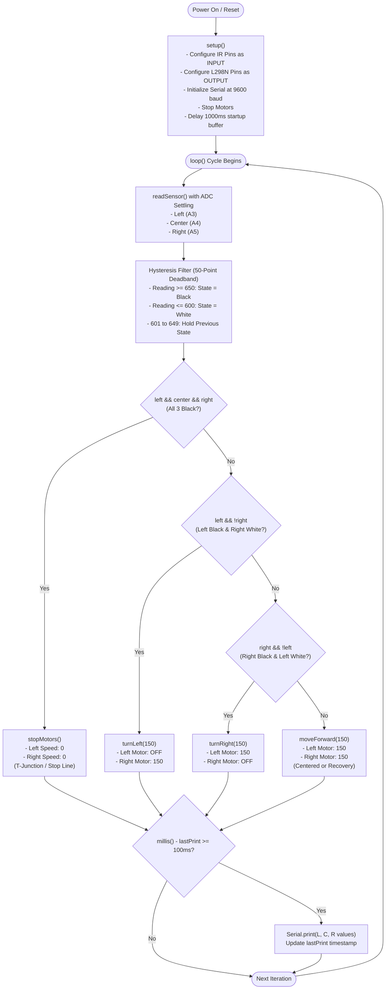
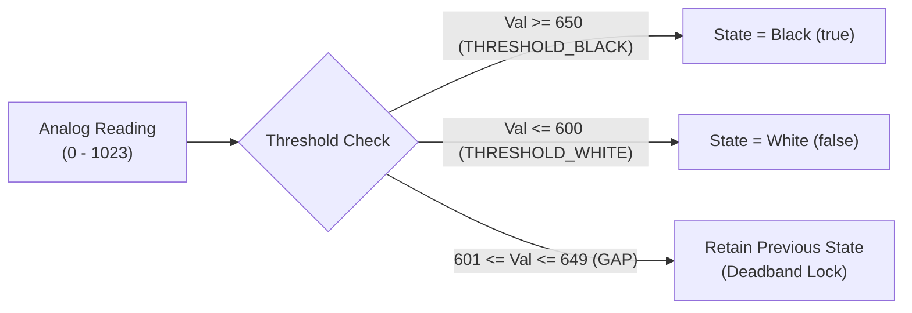

# 3-Sensor Analog Line Follower Robot (L298N + Arduino Uno)

An autonomous 3-sensor analog line-following robot powered by an Arduino Uno and an L298N dual H-bridge motor driver. The firmware uses analog thresholding with Schmitt-trigger-style hysteresis and ADC settling delays to ensure smooth, jitter-free navigation along black lines on white surfaces.

---

## Table of Contents

1. [Hardware Architecture](#hardware-architecture)
   - [Bill of Materials](#bill-of-materials)
   - [Wiring & Pinout](#wiring--pinout)
2. [Software Architecture & Control Flow](#software-architecture--control-flow)
   - [System Flowchart](#system-flowchart)
   - [ADC Settling & Crosstalk Elimination](#adc-settling--crosstalk-elimination)
   - [Hysteresis Filtering (Deadband)](#hysteresis-filtering-deadband)
   - [Decision Matrix & Steering Logic](#decision-matrix--steering-logic)
3. [Motor Truth Table](#motor-truth-table)
4. [Tuning & Calibration](#tuning--calibration)
5. [Getting Started (PlatformIO)](#getting-started-platformio)
   - [Build & Upload](#build--upload)
   - [Serial Telemetry](#serial-telemetry)

---

## Hardware Architecture

### Bill of Materials

| Component | Quantity | Purpose |
| :--- | :---: | :--- |
| **Arduino Uno** (ATmega328P) | 1 | Central microcontroller |
| **L298N Motor Driver Module** | 1 | Dual H-bridge motor controller for DC gearmotors |
| **Analog IR Reflectance Sensors** | 3 | Line detection array (Left, Center, Right) |
| **TT Gearmotors with Wheels** | 2 | Differential drive robot chassis |
| **Battery Pack** | 1 | 7.4V (2S Li-ion) or 11.1V (3S Li-ion) to power L298N & Arduino |
| **Caster Wheel** | 1 | Front/rear omnidirectional support |

---

### Wiring & Pinout

#### 1. L298N Motor Driver Connection

| Arduino Uno Pin | L298N Pin | Function | Notes |
| :---: | :---: | :--- | :--- |
| **D9** | **ENA** | Left Motor Speed | PWM output (0 - 255) |
| **D8** | **IN1** | Left Motor Direction 1 | Logic Level |
| **D7** | **IN2** | Left Motor Direction 2 | Logic Level |
| **D5** | **IN3** | Right Motor Direction 1 | Logic Level |
| **D4** | **IN4** | Right Motor Direction 2 | Logic Level |
| **D3** | **ENB** | Right Motor Speed | PWM output (0 - 255) |
| **GND** | **GND** | Common Ground | **Must share ground with battery & Arduino** |
| *VIN / 5V* | *5V Logic* | Logic Power | If 12V jumper enabled, 5V pin acts as 5V output |

#### 2. Analog IR Sensor Array Connection

| Sensor | Arduino Analog Pin | Code Identifier | Description |
| :--- | :---: | :---: | :--- |
| **Left IR Sensor** | **A3** | `ir_left` | Detects left boundary of the line |
| **Center IR Sensor** | **A4** | `ir_center` | Detects center of the track |
| **Right IR Sensor** | **A5** | `ir_right` | Detects right boundary of the line |
| **VCC** | **5V** | — | Sensor Power Supply |
| **GND** | **GND** | — | Ground Reference |

---

## Software Architecture & Control Flow

### System Flowchart



---

### ADC Settling & Crosstalk Elimination

The ATmega328P microcontroller has a single shared internal Analog-to-Digital Converter (ADC) connected to an internal multiplexer. When switching rapidly between analog channels (`A3`, `A4`, `A5`), residual charge in the sample-and-hold capacitor can cause channel crosstalk (ghosting).

The firmware resolves this in `readSensor()`:
```cpp
int readSensor(int pin) {
  analogRead(pin);        // 1. Dummy read switches the internal ADC multiplexer channel
  delayMicroseconds(20);  // 2. 20-microsecond delay lets sample capacitor fully settle
  return analogRead(pin); // 3. True high-accuracy conversion
}
```

---

### Hysteresis Filtering (Deadband)

To eliminate rapid relay/motor toggling and hunting behavior around edge boundaries, a 50-point hysteresis deadband is implemented:



- **White Threshold**: `<= 600`
- **Deadband Gap**: `50` units
- **Black Threshold**: `>= 650`

---

### Decision Matrix & Steering Logic

The control algorithm prioritizes stop markers and sharp deviations before applying default forward propulsion:

| State | Left IR (`A3`) | Center IR (`A4`) | Right IR (`A5`) | Robot Action | Motor Speeds |
| :---: | :---: | :---: | :---: | :--- | :--- |
| **1** | **Black** | **Black** | **Black** | **Stop Motors** (Intersection / End Line) | Left: 0 \| Right: 0 |
| **2** | **Black** | Any | White | **Turn Left** (Vehicle drifting right) | Left: 0 \| Right: 150 |
| **3** | White | Any | **Black** | **Turn Right** (Vehicle drifting left) | Left: 150 \| Right: 0 |
| **4** | White | **Black** | White | **Drive Forward** (Line centered) | Left: 150 \| Right: 150 |
| **5** | White | White | White | **Drive Forward** (Coast / Bridge gaps) | Left: 150 \| Right: 150 |

---

## Motor Truth Table

The L298N direction inputs and PWM channels are driven as follows:

| Function | ENA (D9) | IN1 (D8) | IN2 (D7) | ENB (D3) | IN3 (D5) | IN4 (D4) | Description |
| :--- | :---: | :---: | :---: | :---: | :---: | :---: | :--- |
| **`forward()`** | `150` | HIGH | LOW | `150` | HIGH | LOW | Both wheels forward |
| **`turnLeft()`** | `0` | LOW | LOW | `150` | HIGH | LOW | Left stopped, Right forward |
| **`turnRight()`** | `150` | HIGH | LOW | `0` | LOW | LOW | Left forward, Right stopped |
| **`stopMotors()`** | `0` | LOW | LOW | `0` | LOW | LOW | All coils disabled / coast to stop |

---

## Tuning & Calibration

If the robot operates in a different ambient light environment or track surface, adjust these constants in `src/main.cpp`:

```cpp
// Speed Settings (Range: 0 to 255)
const int forwardSpeed = 150; // Straight-line cruising speed
const int turnSpeed    = 150; // Turning maneuver speed

// Threshold Settings (Range: 0 to 1023)
const int THRESHOLD_WHITE = 600;                   // Maximum reading for white surface
const int GAP = 50;                                // Deadband buffer zone
const int THRESHOLD_BLACK = THRESHOLD_WHITE + GAP; // Minimum reading for black surface (650)
```

### Calibration Steps
1. Place sensor over the **white surface** and observe the serial monitor. Let the maximum reading be $V_{white}$.
2. Place sensor over the **black line** and observe the serial monitor. Let the minimum reading be $V_{black}$.
3. Set `THRESHOLD_WHITE = V_white + 50` and `GAP = (V_black - V_white) / 4`.

---

## Getting Started (PlatformIO)

### Build & Upload

This project is configured for PlatformIO (`platformio.ini` targeting Arduino Uno):

```bash
# Compile the firmware
pio run

# Upload to the connected Arduino Uno
pio run --target upload

# Open the serial monitor (9600 baud)
pio device monitor
```

### Serial Telemetry

When connected to a terminal at 9600 baud, the robot outputs continuous telemetry every 100 milliseconds without interrupting motor execution:

```text
========================================
 Analog Line Follower Started
 White <= 600 | Gap: 50 | Black >= 650
========================================
L:210 C:780 R:195
L:205 C:790 R:200
L:680 C:620 R:180
...
```
- **L**: Raw analog reading of the Left IR sensor
- **C**: Raw analog reading of the Center IR sensor
- **R**: Raw analog reading of the Right IR sensor

